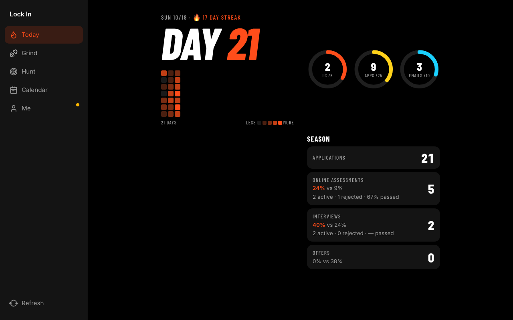
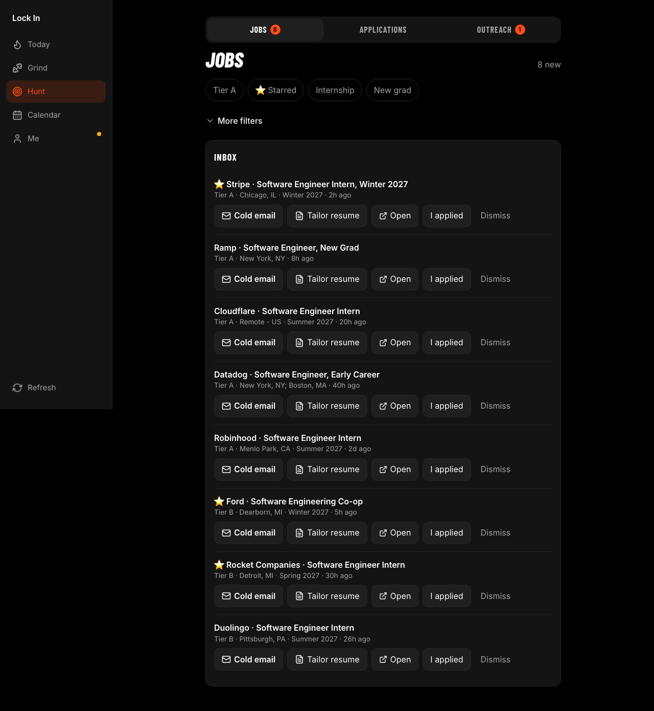
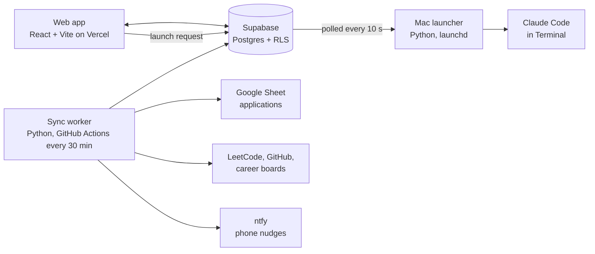

# Lock In

A personal training app for internship and new-grad recruiting season. It tracks every kind of work that moves a job search forward (LeetCode, applications, recruiter outreach, project commits and interview prep), shows it as a daily streak, and hands the slow parts to Claude Code sessions on my Mac.

I built it for myself and use it every day. It's not a hosted product: you'd need your own Supabase project, Google Sheet and Mac to run it.

  
  

Screens from demo mode (made-up data).

## What it does

- **Today**: Day N of the season, an any-work streak, a GitHub-style activity heatmap, weekly rings (LeetCode, applications, emails) and an application funnel compared against a benchmark season.
- **Grind**: a daily LeetCode set chosen by spaced repetition across a problem roadmap, plus interview prep (a story bank, a fundamentals checklist, company prep and mock interviews).
- **Hunt**: new early-career postings from about 200 companies' career sites, sorted by how much I want each company, applications synced from my tracking Sheet, and outreach cards that follow each recruiter email from draft to follow-up.
- **Projects**: commit strips for my side projects and an idea list. **Work on this** opens a briefed Claude Code session in that project's folder.
- **Tailor resume**: Claude first checks the fit (degree level, graduation date, role type) and stops early if the posting isn't for me, offering to drop it from the app. Otherwise the Mac copies my base LaTeX resume, has Claude tailor it to the posting, compiles it with tectonic, checks it's exactly one page, saves it next to my other resumes, then drafts one recruiter email for me to review and send.
- **Me**: my profile (which the Claude prompts read), a season record, and every tailored resume with its path.
- **Calendar**, a shareable progress card, and phone nudges through ntfy.

Claude never sends, applies or pushes anything on its own. Every session is interactive, and I approve each command.

## How it fits together

- **`web/`**: React 19, TypeScript, TanStack Query and Vite. It's installable as a PWA, with no UI kit or chart library. `web/api/` holds two Vercel functions (LeetCode sync, Sheet writes).
- **`worker/`**: Python 3.12.
  - `lockin_worker` handles the scheduled sync, streaks, the daily set, nudges and the Mac launcher.
  - `job_radar` fetches postings from 214 companies: job boards (Greenhouse, Lever, Ashby, Workday, SmartRecruiters, Eightfold, Oracle) and the career sites of Google, Apple, Amazon, Meta and IBM, plus community GitHub lists.
- **`prompts/`**: the briefs each Claude Code session starts from.
- **`supabase/migrations/`**: the schema, with row-level security on every table.

Buttons in the app never run code on the Mac directly. They insert a row into `launch_requests`, and the launcher polls for it, builds the prompt, opens Claude Code in Terminal and records the result on the row. So the card can show "Queued for Mac", "Opened on Mac" or the error.

## Running it

- Demo mode, with fixture data and no accounts: `cd web && npm install && npm run dev:demo`
- Tests: `cd web && npm test` (Vitest) and `npm run e2e` (Playwright); `cd worker && pip install -e '.[dev]' && pytest`
- Full setup (Supabase, the Sheet, GitHub secrets, the Mac launcher, Vercel): [docs/setup.md](docs/setup.md)

Design notes and build plans are in [docs/](docs/).

## License

[MIT](LICENSE)
