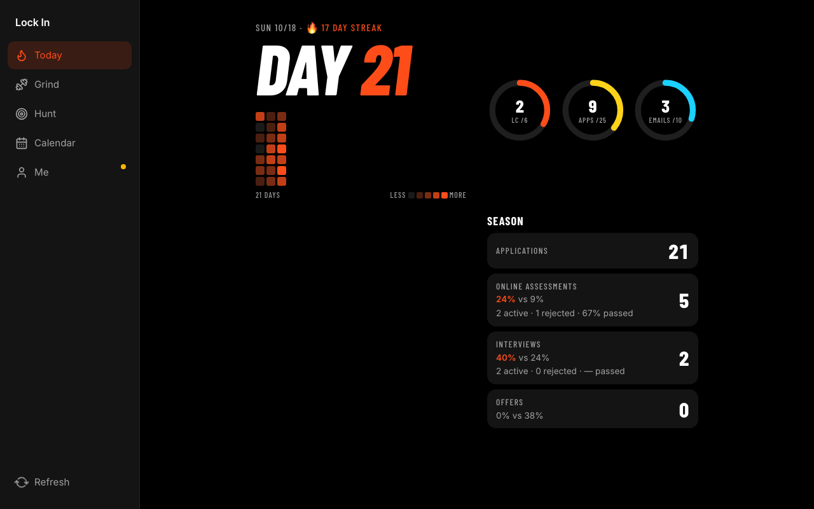
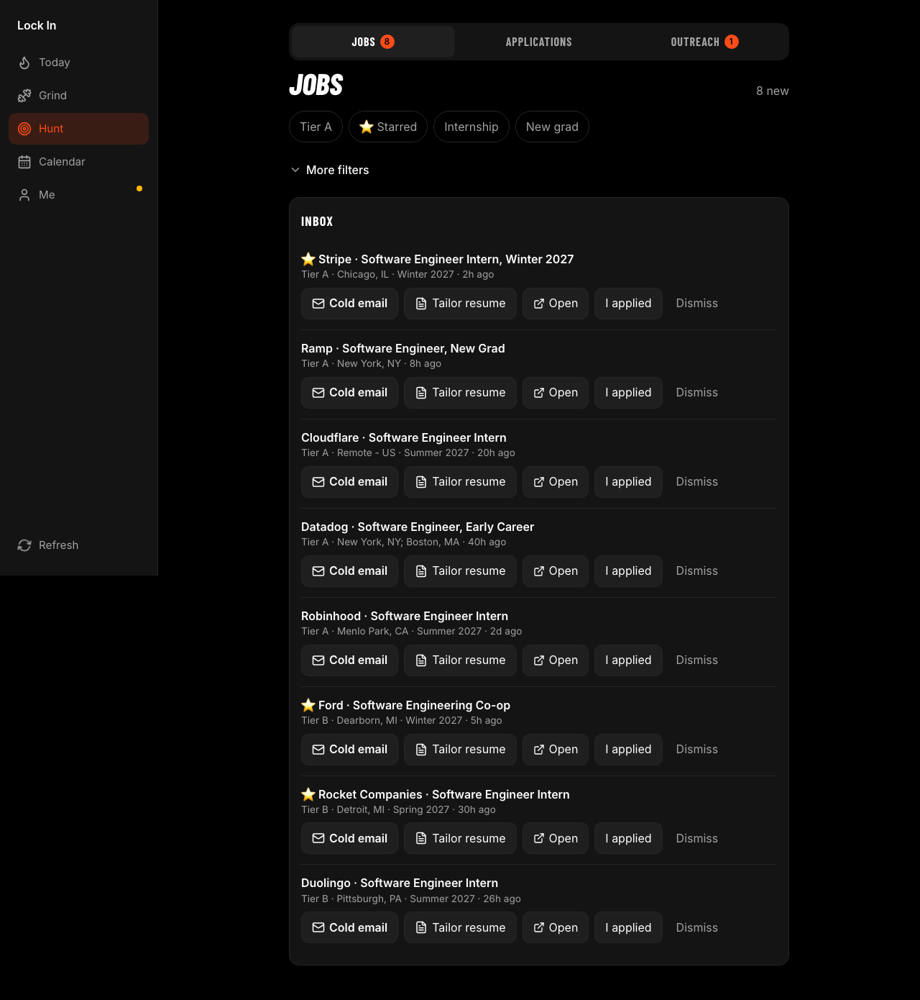
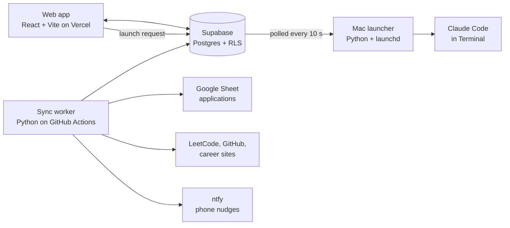

# Lock In

**A daily training system for software-engineering recruiting season.**

Lock In puts every part of an internship or new-grad search in one app: LeetCode practice, job postings, applications, recruiter and engineer outreach, and interview prep. It counts all of that work toward one daily streak. The slow parts, like tailoring a resume or finding an engineer to contact, are handed to interactive Claude Code sessions that run on a local Mac.

<p>
  
  
</p>
<sub>Screenshots from demo mode, using made-up data.</sub>

> [!NOTE]
> Lock In is a personal tool, not a hosted product. Running it yourself needs your own Supabase project, Google Sheet and Mac. [Demo mode](#quick-start) runs with no accounts.

## Features

### Practice
- **Daily LeetCode set** chosen by spaced repetition across a problem roadmap.
- **Interview prep**: a story bank, a fundamentals checklist, company research and mock interviews.
- **Learning tracks** in CS, math and startups. Each module pairs a free course with practice, a project and a short quiz. Finished modules come back for review at 3, 7, 21, 60 and 120 days.

### Job search
- **Posting scanner** that checks about 300 company career sites every 10 minutes. It sorts postings into tiers (Reach, Midwest, Volume), merges duplicates, and filters out roles that ask for a PhD, 2+ years of experience or a different graduation date.
- **Resume tailoring**: Claude first checks whether the role fits, then edits a LaTeX base resume for the posting, compiles it, makes sure it is exactly one page and drafts a recruiter email.
- **Application autofill**: Claude in Chrome fills out the application using the tailored resume. It skips demographic questions and stops before **Submit** so you can review it.
- **Engineer outreach**: for top-tier roles, Claude finds engineers at the company and drafts a LinkedIn note. Each contact is tracked from draft through referral, with follow-up reminders.

### Progress
- **Today dashboard**: day count, streak, an activity heatmap, weekly goals and an application funnel compared against a benchmark season.
- **Season report**: export all data as JSON, or generate a PDF report with charts.
- **Phone nudges** through ntfy, a calendar and a shareable progress card.

**Nothing is sent without approval.** Claude never sends a message, submits an application or pushes code on its own. Each session is interactive, and every command needs approval.

## Architecture



The web app never runs code on the Mac directly. A button inserts a row into `launch_requests`. The Mac launcher polls for new rows, builds the prompt, opens Claude Code in Terminal and writes the result back to the row. That is how each card can show **Queued**, **Opened** or the error.

| Path | Contents |
| --- | --- |
| `web/` | React 19, TypeScript, TanStack Query and Vite. Installable as a PWA and built without a UI kit or chart library. `web/api/` holds Vercel functions for LeetCode sync and Sheet writes. |
| `worker/lockin_worker` | Python 3.12. Scheduled sync, streaks, the daily set, nudges and the Mac launcher. |
| `worker/job_radar` | The posting scanner. It reads Greenhouse, Lever, Ashby, Workday, SmartRecruiters, Eightfold and Oracle boards, the career sites of Google, Apple, Amazon, Meta and IBM, and community GitHub lists. Companies are listed in `worker/config/companies.yaml`. |
| `prompts/` | The starting brief for each kind of Claude Code session. |
| `supabase/migrations/` | Database schema, with row-level security on every table. |

## Quick start

Run the app with demo data and no accounts:

```sh
cd web
npm install
npm run dev:demo
```

For a full setup (Supabase, the Google Sheet, GitHub secrets, the Mac launcher and Vercel), see [docs/setup.md](docs/setup.md).

## Testing

```sh
# Web: unit tests (Vitest) and end-to-end tests (Playwright)
cd web && npm test && npm run e2e

# Worker
cd worker && pip install -e '.[dev]' && pytest
```

## Documentation

- [Setup guide](docs/setup.md)
- [Build decisions](docs/build-decisions.md)
- More design notes and plans are in [`docs/`](docs/).

## License

[MIT](LICENSE)
